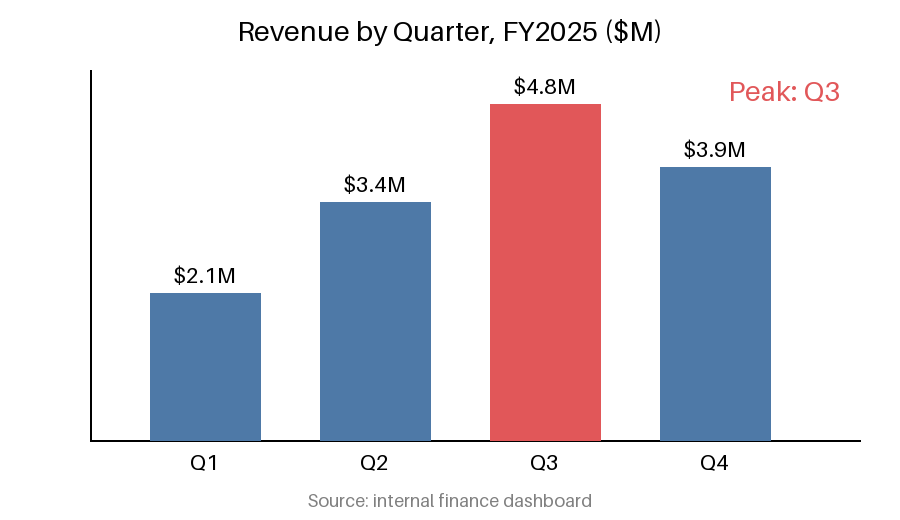

# Acme Corp FY2025 Quarterly Report

This report summarizes Acme Corp's financial and operational performance for fiscal year 2025.
Revenue grew steadily through the year, driven by the enterprise segment and expansion into new regions.

## Revenue Trend

The chart below shows revenue for each quarter of the fiscal year.

## Units Shipped by Region

Unit shipments for the full year are broken down by region in the following table.

| Region        | Units Shipped | YoY Growth |
|---------------|---------------|------------|
| North America | 12,400        | 8%         |
| Europe        | 9,150         | 12%        |
| Asia Pacific  | 15,720        | 21%        |
| Latin America | 3,060         | 5%         |

## Outlook

Management expects continued growth in FY2026, with Asia Pacific remaining the fastest-growing region.
