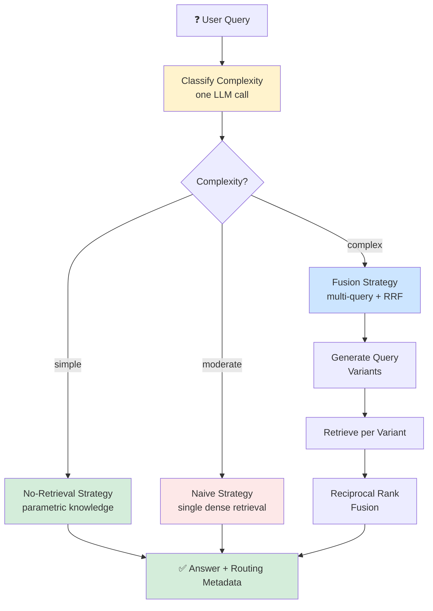
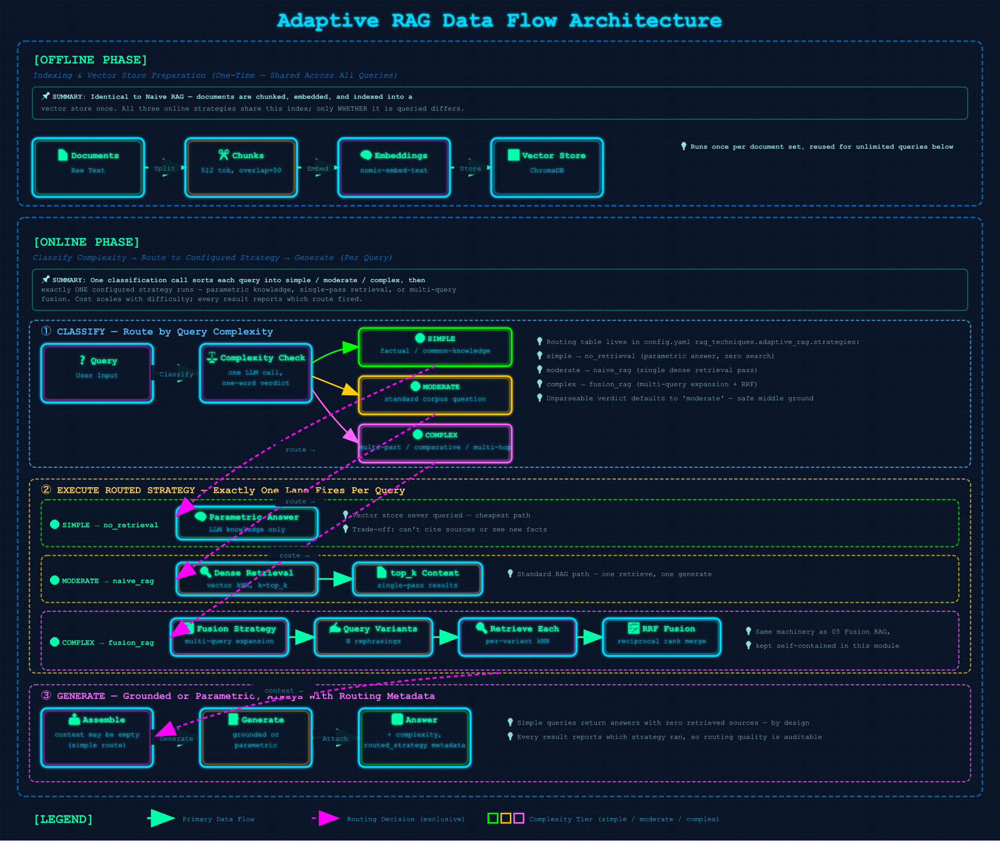

# 10 · Adaptive RAG

> **Category:** Adaptive & Self-Reflective  
> **Complexity:** ⭐⭐⭐☆☆  
> **Latency:** 🟡 Varies (cheap for simple queries, expensive only when warranted)  
> **Accuracy:** 🟢 High (hard questions get heavy machinery, easy ones don't pay for it)  
> **Reference:** [NirDiamant/RAG_Techniques](https://github.com/NirDiamant/RAG_Techniques)  
> **Paper:** ["Adaptive-RAG: Learning to Adapt Retrieval-Augmented LLMs through Question Complexity" — Jeong et al., 2024](https://arxiv.org/abs/2403.14403)

---

## What Is It?

Every technique in this repo answers every query with the same pipeline. Adaptive RAG's insight is that **not all questions deserve the same treatment**. "What is the capital of France?" doesn't need retrieval at all — and running it through a multi-query fusion pipeline wastes latency and tokens. Meanwhile, "Compare the energy efficiency of the three approaches discussed across these documents" genuinely needs evidence gathered from several angles.

Adaptive RAG puts a **classifier in front of the pipeline**:

1. **Classify** the incoming query into one of three complexity levels with a single LLM call:
   - **Simple** — factual/common-knowledge, answerable without any documents.
   - **Moderate** — corpus-specific, standard retrieval handles it.
   - **Complex** — multi-part, comparative, or multi-hop; needs broad evidence gathering.
2. **Route** to the strategy configured for that level (defaults from `config.yaml`):
   - `simple` → **No-Retrieval**: answer directly from parametric knowledge. Zero retrieval cost.
   - `moderate` → **Naive RAG**: one dense retrieval pass, generate from the results.
   - `complex` → **Fusion RAG**: generate query rephrasings, retrieve per variant, fuse with Reciprocal Rank Fusion, generate from the merged pool.
3. **Generate** — the routed strategy produces the answer; routing metadata is attached so callers can see which path ran.

The result is **cost/latency proportionality**: trivial questions stay cheap, hard questions get the expensive pipeline — all behind one endpoint.

---

## Flowchart



---

## Data Flow Diagram

### Offline Phase (Indexing)
**Documents → Chunks → Embeddings → Vector Store**

Identical to Naive RAG. All three online strategies share the same index; only *whether* and *how many times* it is queried differs.

### Online Phase (Query, Classify-then-Route)
**Query → Classify Complexity → Dispatch to Configured Strategy → (Optional Retrieval Paths) → Generate → Answer + Routing Metadata**

Exactly one classification call runs per query, then exactly one strategy executes. The chosen complexity level and strategy are returned in `RAGResult.metadata` (`complexity`, `routed_strategy`) and in the routing step under `intermediate_steps`.



---

## Implementation Files

| File | Framework | Key Features |
|------|-----------|--------------|
| `langchain_impl.py` | LangChain | LCEL classify/route chains, strategy dispatch table, inline RAG-Fusion complex path |
| `llamaindex_impl.py` | LlamaIndex | Same classification via direct `llm.complete()` calls, shared index retriever |

Both frameworks share identical prompts and routing semantics; unknown strategy names in config fall back to `naive_rag` with a logged warning.

---

## Key Configuration (config.yaml)

```yaml
rag_techniques:
  adaptive_rag:
    enabled: true
    description: "Classify query complexity, route to optimal RAG strategy"
    strategies:
      simple: "no_retrieval"     # Answer from parametric knowledge
      moderate: "naive_rag"      # Single dense retrieval pass
      complex: "fusion_rag"      # Multi-query expansion + RRF fusion
    # Optional overrides for the built-in complex strategy:
    # num_queries: 3             # Total queries fused (original + variants)
    # rrf_k: 60                  # Reciprocal Rank Fusion constant

retrieval:
  top_k: 5                       # Docs retrieved by the naive/fusion strategies
```

Routing is done by an LLM classifier prompt (the paper's classifier variant). The `routing_model` option (`classifier` / `llm_router` / `embedding_router`) is reserved for future router backends — only the LLM classifier is wired up.

---

## Pros & Cons

| ✅ Pros | ❌ Cons |
|---------|---------|
| Latency/cost proportional to question difficulty — most workloads are dominated by easy queries | One extra LLM call on *every* query just to route, even before answering |
| Single endpoint serves mixed workloads without manual strategy selection | Classification errors cascade: mislabeling a complex query as simple skips retrieval entirely |
| Strategies are configurable per complexity level via `config.yaml` | Only three strategies are built in; custom strategies require code changes |
| Routing decisions are surfaced in metadata for observability and evaluation | Classifier quality depends on the LLM following the labeling prompt |

---

## When to Use Adaptive RAG

**✅ Perfect for:**
- Production chatbots facing mixed traffic: mostly easy questions, occasionally hard ones
- Cost-sensitive deployments where paying fusion-pipeline prices for "what is X?" is unacceptable
- Systems that want one stable API surface while internally varying retrieval depth

**❌ Consider alternatives when:**
- Nearly all your traffic is corpus-specific → classification overhead buys little over plain Naive RAG
- You can't tolerate occasional misrouting → always-on Self-RAG gives finer-grained control at similar cost
- Queries are uniformly hard → run Fusion or Agentic RAG directly and skip the router

---

## Architecture Notes

- **Self-contained strategies.** The naive and fusion paths are implemented inline rather than importing from `01_naive_rag`/`05_fusion_rag`, matching the repo's convention that each technique directory stands alone. The complex path mirrors 05's multi-query + RRF logic with its own configurable `num_queries`/`rrf_k`.
- **Config-driven routing table.** `strategies` maps complexity labels → strategy names, resolved through a dispatch dict at query time. Unknown names log a warning and fall back to `naive_rag` instead of raising — a bad config degrades gracefully rather than breaking the endpoint.
- **Classification failure defaults to moderate.** If the model returns garbage, `_parse_complexity` falls back to `"moderate"`, the safest middle ground: retrieval still happens, but the expensive fusion path doesn't run unnecessarily.
- **Routing is observable, not hidden.** Every result carries the detected complexity, the routed strategy, and whether retrieval was used — making it possible to evaluate the classifier itself against downstream answer quality.
