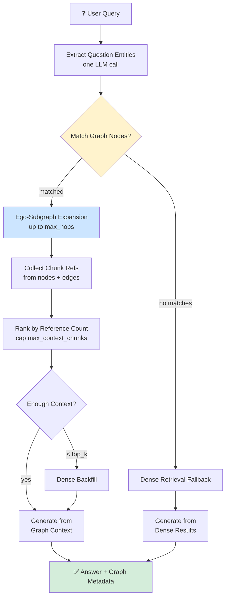
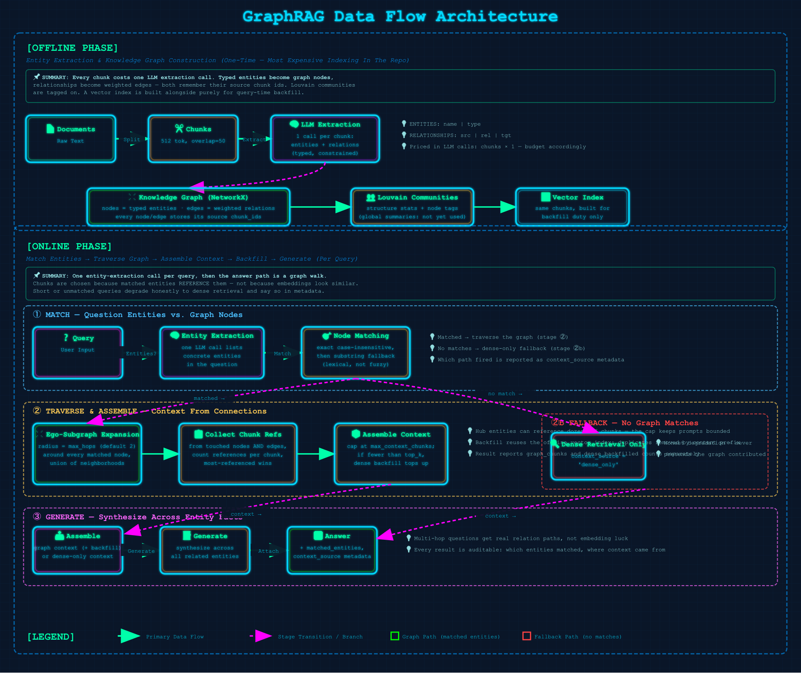

# 11 · GraphRAG

> **Category:** Structural & Specialized  
> **Complexity:** ⭐⭐⭐⭐⭐  
> **Latency:** 🔴 High (expensive indexing; query cost scales with subgraph size)  
> **Accuracy:** 🟢 Very High (explicit relation paths instead of embedding luck)  
> **Reference:** [NirDiamant/RAG_Techniques](https://github.com/NirDiamant/RAG_Techniques)  
> **Paper:** ["From Local to Global: A Graph RAG Approach to Query-Focused Summarization" — Edge et al., Microsoft, 2024](https://arxiv.org/abs/2404.16130)

---

## What Is It?

Every technique before this one asks the same question at query time: *which chunks look like the question?* GraphRAG changes the question to *which facts are connected to the entities involved?* During indexing, an LLM reads every chunk and extracts **typed entities** (people, organizations, locations, concepts…) and the **relationships between them**. Those become nodes and edges in a knowledge graph, where repeated mentions strengthen edge weights and every node/edge remembers which chunk it came from.

At query time:

1. **Extract question entities** — one LLM call lists the concrete entities the question is about.
2. **Match** those names against graph nodes (exact match, then substring fallback).
3. **Traverse** — expand each matched node's neighborhood up to `max_hops` and collect every chunk referenced by the touched nodes and edges.
4. **Assemble** — rank the collected chunks by how many times matched entities reference them; keep the top `max_context_chunks`.
5. **Backfill** — if the graph yielded fewer than `top_k` chunks, top up with ordinary dense retrieval.
6. **Generate** — answer from the assembled context.

The payoff shows up on multi-hop questions ("Who did X collaborate with, and what came out of that work?"): the context arrives because *explicit relations connect the hops*, not because a single embedding happened to sit near both ends of the chain.

---

## Flowchart



---

## Data Flow Diagram

### Offline Phase (Indexing — Expensive, One-Time)
**Documents → Chunks → Per-Chunk Entity/Relation Extraction → Knowledge Graph (+ Vector Index)**

Each chunk costs one LLM extraction call — GraphRAG's indexing is deliberately the priciest in this repo. The output is a NetworkX `Graph`: typed entity nodes carrying their source chunk ids, weighted edges carrying relation phrases, plus Louvain community detection over the whole structure. A conventional vector index is built alongside purely for backfill duty.

### Online Phase (Query, Traverse-then-Backfill)
**Question → Extract Entities → Match Nodes → Expand Subgraph → Assemble Chunks → (Dense Backfill) → Generate → Answer**

Exactly one entity-extraction call runs per query. If nothing matches the graph, the pipeline degrades honestly to dense-only retrieval rather than failing.



---

## Implementation Files

| File | Framework | Key Features |
|------|-----------|--------------|
| `langchain_impl.py` | LangChain | LCEL extraction chains, NetworkX graph build + Louvain, ego-graph traversal with chunk back-references |
| `llamaindex_impl.py` | LlamaIndex | Same extraction via direct `llm.complete()` calls; vector index used only for backfill |

Both frameworks share identical prompts, parsing, and traversal semantics. Only the `networkx` graph store is implemented; a configured `neo4j` store logs a warning and falls back to in-memory NetworkX.

---

## Key Configuration (config.yaml)

```yaml
rag_techniques:
  graph_rag:
    enabled: true
    description: "Extract entities/relations, build graph, query with traversal"
    graph_store: "networkx"         # Only networkx implemented; neo4j warns + falls back
    entity_types:                   # Extraction is restricted to these types
      - PERSON
      - ORGANIZATION
      - LOCATION
      - CONCEPT
      - EVENT
      - TECHNOLOGY
    community_detection: true       # Louvain communities tagged onto nodes
    community_algorithm: "louvain"
    # Optional overrides (defaults shown):
    # max_hops: 2                   # Neighborhood radius around matched entities
    # max_context_chunks: 12        # Cap on graph-assembled context chunks

retrieval:
  top_k: 5                          # Dense-backfill budget per query
```

---

## Pros & Cons

| ✅ Pros | ❌ Cons |
|---------|---------|
| Multi-hop reasoning becomes explicit graph walks, not embedding coincidence | Most expensive indexing in the repo — one LLM extraction call per chunk |
| Edge weights and chunk back-references make context selection interpretable | Answer quality is hostage to extraction quality; missed entities are invisible holes |
| Graceful degradation: no graph matches still answers via dense retrieval | Community detection runs but isn't yet used for global-summarization queries |
| Entity types constrain the schema, keeping graphs clean and queryable | Entity matching is lexical (exact/substring); paraphrased names can fail to match |

---

## When to Use GraphRAG

**✅ Perfect for:**
- Entity-dense corpora: research papers, meeting notes, news archives, medical records
- Questions about relationships, influence, collaboration, or causation chains
- Static or slowly changing corpora where expensive one-time indexing pays off

**❌ Consider alternatives when:**
- Your corpus churns constantly — re-extraction per update gets expensive fast
- Queries are simple lookups → Naive RAG answers them without the graph overhead
- You need global "summarize the whole corpus" answers → that's the paper's community-summary mode, not implemented here

---

## Architecture Notes

- **Chunks are the join key.** Every node and edge stores the chunk ids it was extracted from; traversal collects those references, so graph hits translate directly into retrievable text without re-searching.
- **Reference counting drives assembly.** Chunks mentioned by more matched entities win; ties break toward earlier chunks. The cap (`max_context_chunks`) keeps prompts bounded even when a hub entity connects half the corpus.
- **Communities are computed but not yet exploited.** Louvain runs at index time and tags every node (visible in logs and node metadata), mirroring the paper's structure — but the global-search mode that summarizes communities isn't implemented. Local traversal queries don't need it.
- **Honest fallbacks everywhere.** Unmatched questions fall back to dense-only retrieval with `context_source: "dense_only"` reported in metadata; short graph contexts report exactly how many chunks were backfilled. Nothing silently pretends the graph contributed.
