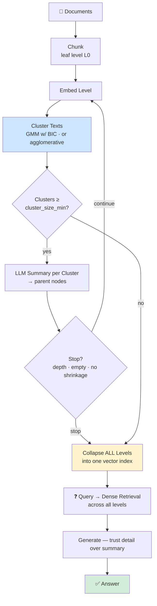
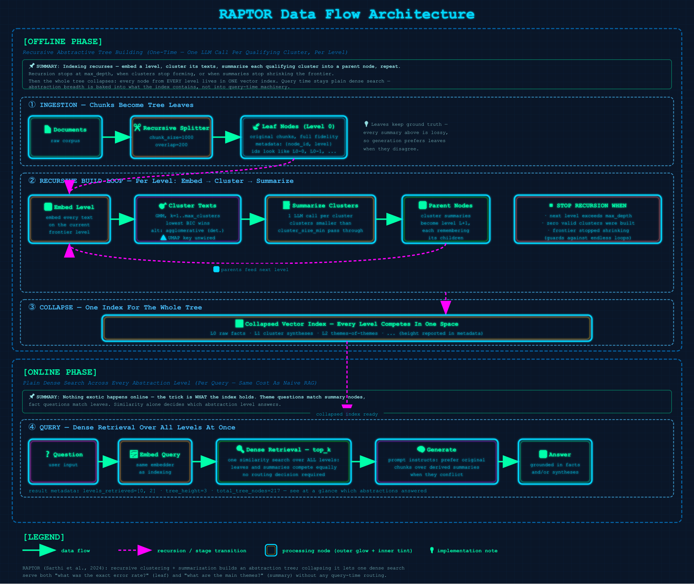

# 12 · RAPTOR

> **Category:** Structural & Specialized  
> **Complexity:** ⭐⭐⭐⭐⭐  
> **Latency:** 🔴 High (expensive recursive indexing; query cost is standard dense)  
> **Accuracy:** 🟢 Very High (retrieval spans fact-level chunks to corpus-level summaries)  
> **Reference:** [NirDiamant/RAG_Techniques](https://github.com/NirDiamant/RAG_Techniques)  
> **Paper:** ["RAPTOR: Recursive Abstractive Processing for Tree-Organized Retrieval" — Sarthi et al., 2024](https://arxiv.org/abs/2401.18059)

---

## What Is It?

Flat vector indexes have a granularity problem: a question like *"What are the main themes of this report?"* needs a synthesis that no single chunk contains, while *"What was the exact error rate?"* needs one specific sentence. Retrieving chunks for the first question gives you fragments; retrieving them for the second gives you noise.

RAPTOR solves this by building a **summary tree** at index time and querying it **collapsed**:

1. **Leaf level** — ordinary document chunks.
2. **Cluster** — embed the level's texts and group them (GMM with BIC model selection over `k`, or deterministic agglomerative fallback).
3. **Summarize** — every cluster of at least `cluster_size_min` members gets one LLM summary call; each summary becomes a node at the next level up, remembering its children.
4. **Recurse** — repeat on the new level until `max_depth`, no valid clusters form, or summaries stop shrinking the frontier.
5. **Collapse** — every node from *every* level goes into ONE vector index.

At query time it's plain dense retrieval — but across all abstraction levels at once. Detail questions pull leaf chunks; synthesis questions pull mid-tree or top-tree summaries. No query rewriting, no special handling.

---

## Flowchart



---

## Data Flow Diagram

### Offline Phase (Indexing — Recursive, One-Time)
**Documents → Chunks → [Embed → Cluster → Summarize]×max_depth → Collapsed Vector Index**

Each level costs `(#clusters ≥ min size)` LLM calls plus one embedding pass. The tree stops growing when depth runs out, clusters stop forming, or summarization stops shrinking the frontier. Every node carries `{node_id, level}` metadata into the single collapsed index.

### Online Phase (Query — Standard Dense, Multi-Level Results)
**Question → Embed → top_k over ALL levels → Generate**

The only structural difference from Naive RAG is what's *in* the index. Result metadata reports which tree levels were retrieved (`levels_retrieved`) so you can see whether a question pulled facts (L0), syntheses (L1+), or both.



---

## Implementation Files

| File | Framework | Key Features |
|------|-----------|--------------|
| `langchain_impl.py` | LangChain | LCEL summarize chains, sklearn GMM/agglomerative clustering, collapsed LC vector store |
| `llamaindex_impl.py` | LlamaIndex | Same recursion via direct `llm.complete()` calls, embedding-batch API, collapsed `VectorStoreIndex` |

Both frameworks share identical prompts, clustering code, and stop rules.

---

## Key Configuration (config.yaml)

```yaml
rag_techniques:
  raptor_rag:
    enabled: true
    description: "Cluster docs → summarize clusters → build tree → query at depth"
    max_depth: 3                  # Levels above the leaves
    cluster_size_min: 2           # Clusters smaller than this aren't summarized
    cluster_size_max: 10          # Upper bound on GMM candidate k per level
    summary_chunk_size: 1000      # Char budget for text fed to each summary call
    clustering_algorithm: "gmm"   # gmm (BIC-selected) | agglomerative (deterministic)
    dimensionality_reduction: "umap"  # ⚠️ not implemented — clustering runs in full dim

retrieval:
  top_k: 5                        # Sources retrieved across all levels
```

---

## Pros & Cons

| ✅ Pros | ❌ Cons |
|---------|---------|
| One index answers detail AND synthesis questions well | Indexing is expensive: embeddings + one LLM call per cluster, per level |
| Zero extra query-time machinery over Naive RAG | GMM/BIC clustering is sensitive to sample size and embedding geometry |
| Tree metadata makes retrieval auditable (which abstraction answered?) | Corpus updates can invalidate parent summaries — trees want static data |
| Deterministic `agglomerative` option for reproducible builds | The paper's UMAP pre-processing isn't implemented; high-dim clustering is harder |

---

## When to Use RAPTOR

**✅ Perfect for:**
- Research literature, documentation sets, long reports — corpora with hierarchy baked in
- Mixed workloads: factual lookups and "give me the big picture" questions against the same index
- Static corpora where expensive indexing amortizes over many queries

**❌ Consider alternatives when:**
- Your corpus changes constantly — every update may orphan parent summaries
- All your questions are fine-grained facts → the tree is pure overhead vs. Naive RAG
- You need multi-hop entity reasoning → GraphRAG's explicit relations fit better than abstraction levels

---

## Architecture Notes

- **Collapsed-tree retrieval is the whole trick.** The paper's key insight kept intact: don't choose an abstraction level at query time — put every level in one index and let similarity decide. A question's embedding naturally matches a summary when it asks about themes and a leaf when it asks about specifics.
- **Honest simplification of clustering.** The paper uses UMAP → GMM with per-cluster BIC selection in reduced space. This implementation runs GMM directly in full embedding space (UMAP config key warns that it's unwired). BIC picks k from 1..`cluster_size_max`; a deterministic agglomerative mode exists for reproducible tests and builds.
- **Stop rules prevent pathological trees.** Recursion ends when depth runs out, a level produces zero valid clusters, or summaries fail to shrink the frontier — no infinite summarization loops on homogeneous corpora.
- **Detail beats summary on conflict.** The answer prompt instructs the model to trust original chunks over derived summaries when they disagree — summaries can hallucinate slightly during compression, and leaves carry ground truth.
