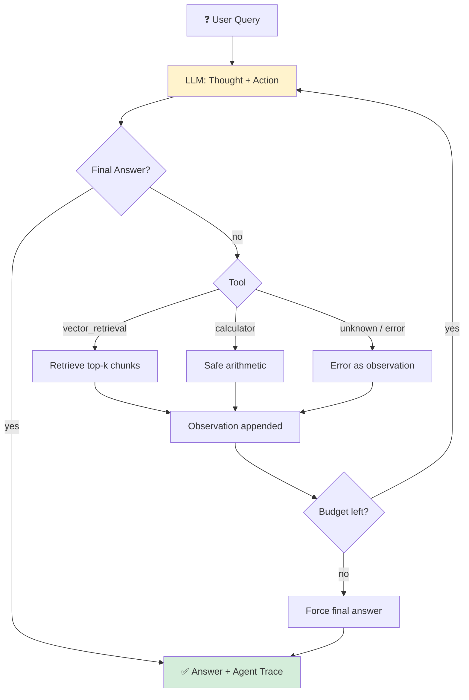
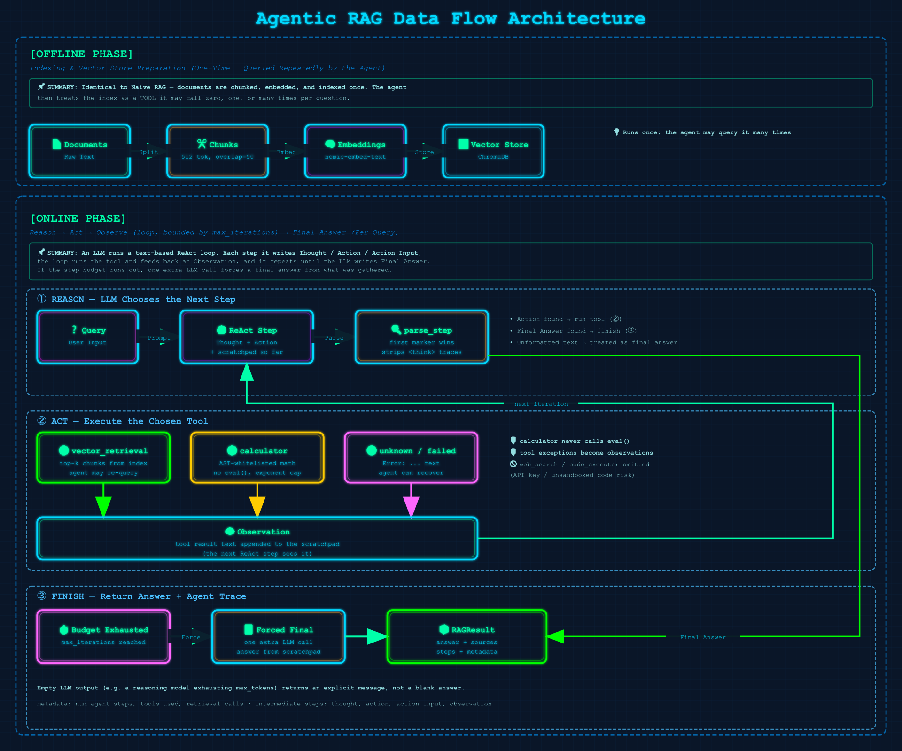

# 13 · Agentic RAG

> **Category:** Agentic  
> **Complexity:** ⭐⭐⭐⭐⭐  
> **Latency:** 🔴 High (one LLM call per agent step, up to `max_iterations` + 1)  
> **Accuracy:** 🟢 Very High on multi-step questions  
> **Reference:** [NirDiamant/RAG_Techniques](https://github.com/NirDiamant/RAG_Techniques)  
> **Paper:** ["ReAct: Synergizing Reasoning and Acting in Language Models" — Yao et al., 2022](https://arxiv.org/abs/2210.03629)

---

## What Is It?

Every earlier technique fixes the pipeline in advance. In Agentic RAG an **LLM agent controls the pipeline**: it decides whether to retrieve, what to search for, whether the results are enough, and when to stop.

The agent runs a **ReAct loop** (`react_loop.py`), emitting plain text in this format:

```
Thought: what I need next
Action: vector_retrieval | calculator
Action Input: the tool input
Observation: <tool result, injected by the loop>
... repeat ...
Thought: I now know the answer
Final Answer: ...
```

**Tools** (from `agentic_rag.tools` in `config.yaml`):
- `vector_retrieval` (always on): search the indexed documents. The agent can call it repeatedly with refined queries.
- `calculator`: arithmetic through a whitelisted AST evaluator (never `eval`).

**Design choices:**
- **Text-based ReAct, not native tool calling.** Local LMStudio models are unreliable at structured tool calls, so the protocol is plain text and works with any model.
- **One loop, two frameworks.** `react_loop.py` takes an LLM callable and a tool dict. The LangChain and LlamaIndex files only supply the LLM and retriever, so agent behavior is identical.
- **Failures are observations.** Unknown tools and tool exceptions go back to the agent as `Error: ...` text so it can recover.
- **Bounded.** After `max_iterations` steps, one extra call forces a final answer.
- **Not included:** web search (needs an API key) and a code executor (arbitrary code execution is a security risk without a real sandbox).

---

## Flowchart



---

## Data Flow Diagram



**Offline:** Documents → Chunks → Embeddings → Vector Store (identical to Naive RAG).

**Online:** Query → ReAct loop (LLM step → tool call → observation, repeated) → Final Answer.

`RAGResult.intermediate_steps` holds one entry per agent step (`thought`, `action`, `action_input`, `observation`). `RAGResult.metadata` holds `num_agent_steps`, `tools_used`, and `retrieval_calls`. `source_documents` is the de-duplicated set of every chunk the agent retrieved.

---

## When to Use

- Multi-hop or comparative questions needing follow-up searches
- Lookups followed by computation ("what is the total of X and Y in the report?")
- Questions where you can't predict how many retrieval rounds are needed

**Avoid when** latency or cost matters and questions are simple. Use Adaptive RAG (10) to route easy queries away from the agent.

## Pros / Cons

| Pros | Cons |
|------|------|
| Handles multi-step questions fixed pipelines can't | Many LLM calls per query |
| Self-corrects by re-searching | Small local models may ignore the format; unformatted output is returned as the answer |
| Extensible: add a `Tool(name, description, fn)` | Non-deterministic path and latency |

---

## Implementation Status

| File | Status |
|------|--------|
| `react_loop.py` | ✅ Shared ReAct loop, parser, safe calculator |
| `langchain_impl.py` | ✅ Done |
| `llamaindex_impl.py` | ✅ Done |
