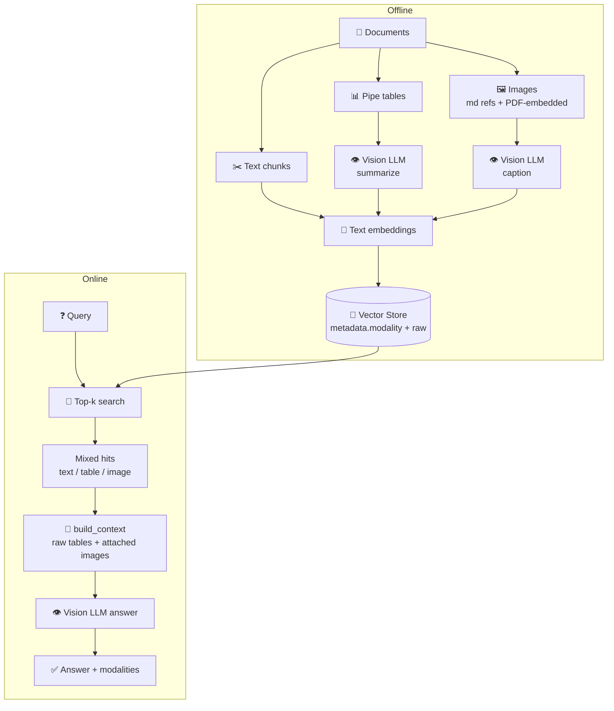
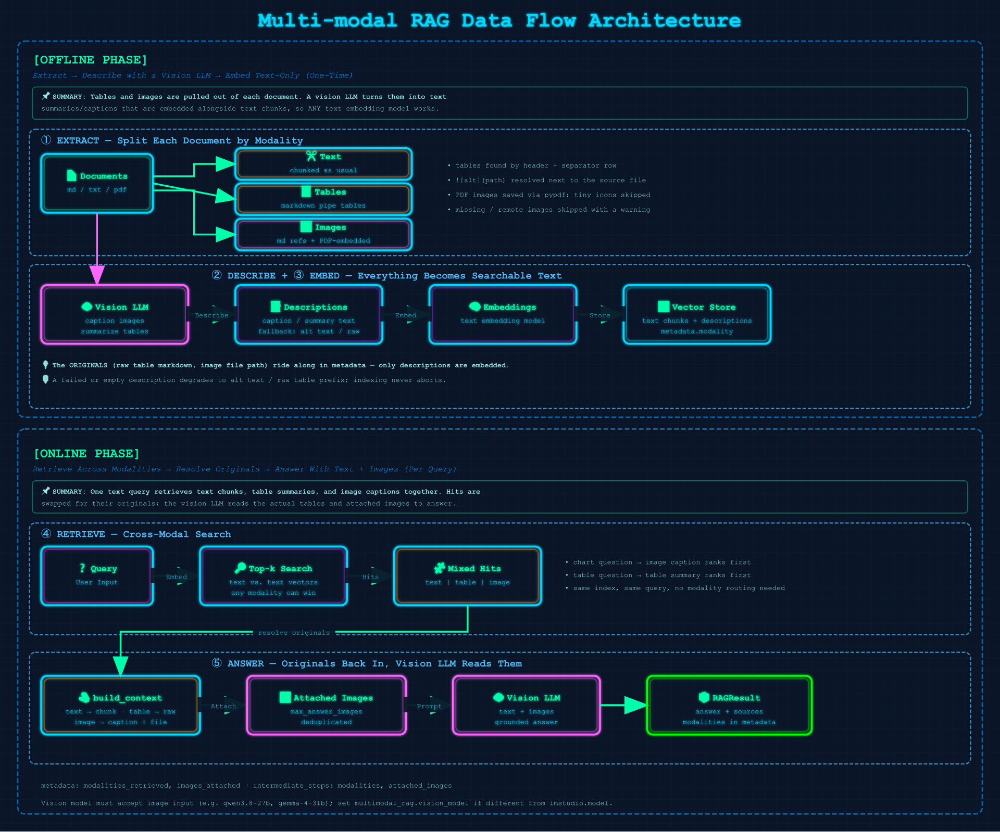

# 14 · Multi-modal RAG

> **Category:** Multi-modal  
> **Complexity:** ⭐⭐⭐⭐☆  
> **Latency:** 🔴 High (vision-LLM calls at index time and at answer time)  
> **Accuracy:** 🟢 High when answers live in charts, figures, or tables  
> **Reference:** [NirDiamant/RAG_Techniques](https://github.com/NirDiamant/RAG_Techniques)

---

## What Is It?

Text-only RAG is blind to the parts of a document that carry the numbers: charts, figures, and tables. Multi-modal RAG makes them first-class retrievable units using **summarize, embed, answer with the original**:

1. **Extract** each document's modalities:
   - **text**: chunked as usual
   - **tables**: markdown pipe tables (header + separator row)
   - **images**: `` references in `.md`/`.txt` files, and images embedded in PDF pages (via `pypdf`)
2. **Describe** with a vision LLM: captions for images, summaries for tables.
3. **Embed** the text, the table summaries, and the image captions together with your normal **text** embedding model. No multimodal embedding model is needed.
4. **Retrieve** with a plain text query. Any modality can rank first.
5. **Answer** with the originals: hits are swapped back for the raw table and the actual image file, and the vision LLM reads the text context **plus the attached images** (up to `max_answer_images`). It reads the chart itself, not just its caption.

**Design choices:**
- **One shared pipeline.** `multimodal.py` holds extraction, description, and answer assembly. The LangChain and LlamaIndex files only handle chunking, the vector store, and retrieval.
- **OpenAI-compatible vision calls.** The vision LLM is called straight through the LM Studio endpoint, so no framework multimodal wrappers are needed.
- **Failures degrade, they don't abort.** A failed or empty description falls back to the alt text or raw table prefix, and indexing continues.
- **Images are assets, not documents.** `load_documents` skips image files in directories, so images referenced from a document never hit the text loader.

---

## Flowchart



---

## Data Flow Diagram



`RAGResult.source_documents` carries each hit's `modality`. `RAGResult.metadata` holds `modalities_retrieved` and `images_attached`. `intermediate_steps` lists the modalities and the image file names attached to the answer.

---

## Try It

A demo report with a chart and a table is in `data/multimodal_demo/`. The peak quarter appears only in the chart, so text-only RAG can't answer it.

```bash
./run.sh run --technique multimodal_rag --docs data/multimodal_demo \
  --query "Which quarter had the highest revenue, and how much was it?"
```

The vision model must accept image input (checked with `qwen/qwen3.8-27b` and `google/gemma-4-31b`). Set `multimodal_rag.vision_model` if it differs from `lmstudio.model`. Reasoning models can exhaust `max_tokens` while thinking, so lower their budget or use a non-thinking model.

---

## When to Use

- PDFs and reports with charts, figures, or tables
- Product catalogs and scientific papers
- Questions whose answer is a number in a chart or a table cell

**Avoid when** documents are pure prose. The vision calls add latency and cost with no benefit.

## Pros / Cons

| Pros | Cons |
|------|------|
| Answers from charts and tables that text RAG misses | Vision-LLM call per image/table at index time |
| Works with any text embedding model | Caption quality bounds retrieval quality |
| Original image reaches the answer model | Needs a vision-capable model on LM Studio |
| One index, no per-modality routing | Only markdown pipe tables and ``/PDF images are detected; scanned pages and HTML tables are not |

---

## Implementation Status

| File | Status |
|------|--------|
| `multimodal.py` | ✅ Shared extraction, vision client, context assembly |
| `langchain_impl.py` | ✅ Done |
| `llamaindex_impl.py` | ✅ Done |
